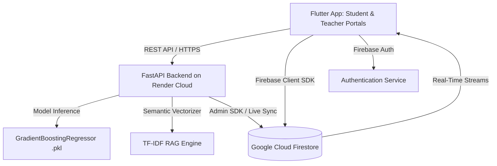

# EduPredict AI — Hackathon Presentation & Pitch Playbook

> **Tagline:** Bridging Machine Learning Predictive Analytics with Real-Time RAG Curriculum Interventions for Higher Education.

---

## Executive Summary & Quick Pitch

- **The Problem:** Educational institutions detect academic failure **too late**—usually after midterms or final exams when students have already accumulated insurmountable backlogs. Generic advice from standard LMS platforms ("study harder") fails because it is neither timely nor actionable.
- **The Solution:** **EduPredict AI** is a closed-loop academic intelligence platform. It pairs a **Gradient Boosting Regressor ML model** (trained on 6,600+ multi-dimensional student records) with a **TF-IDF Semantic RAG (Retrieval-Augmented Generation) engine** to not only forecast exam performance across subjects, but also retrieve personalized, curriculum-aligned remedial actions.
- **The Dual Ecosystem:**
  - **Teacher Portal:** Faculty manage official academic records (attendance, previous semester scores, participation) and upload dynamic curriculum & remedial guidelines (via text or PDFs) into the live RAG index.
  - **Student Portal:** Students log personal lifestyle and study habits (study hours, sleep, motivation) and receive instant, personalized predictions and RAG-curated subject roadmaps.

---

## Slide-by-Slide Presentation Structure

```
+-----------------------------------------------------------------------------------+
| Slide 1: Title & Hook (The Crisis of Late Academic Intervention)                  |
| Slide 2: The Problem (Why Traditional LMS & Grading Fall Short)                   |
| Slide 3: The Solution: EduPredict AI Overview                                     |
| Slide 4: Dual-Role Architecture (Student vs. Faculty Administrative Workflows)    |
| Slide 5: The Machine Learning Core (Dataset, Feature Engineering & Model Metrics) |
| Slide 6: The RAG Pedagogical Engine (How Semantic Context Matching Works)        |
| Slide 7: Complete System Architecture (Flutter + FastAPI + Firebase + Scikit-Learn)|
| Slide 8: Live Demonstration & Real-World User Personas                            |
| Slide 9: Competitive Edge & Key Innovations                                       |
| Slide 10: Scalability, Business Viability & Future Roadmap                         |
| Slide 11: The Team, Tech Stack & Open Source Impact                               |
| Slide 12: Conclusion & Q&A                                                        |
+-----------------------------------------------------------------------------------+
```

---

### Slide 1: Title & Hook
- **Header:** EduPredict AI: Predictive Academic Analytics & RAG-Powered Curriculum Intelligence
- **Subtitle:** Transforming Reactive Grading into Proactive, Data-Driven Student Success
- **Visuals:**
  - Mockup of the mobile app showing the dark blue glassmorphism theme, predicted score gauge (`78.5%`), and crisp RAG recommendation chips.
- **Key Talking Points:**
  - "Every semester, universities lose thousands of capable students not because they lack intelligence, but because academic interventions arrive weeks after the damage is done."
  - "What if professors had an early-warning radar, and students had an AI-powered personalized academic advisor tailored directly to their university's syllabus?"

---

### Slide 2: The Problem
- **Header:** The Broken Feedback Loop in Modern Higher Education
- **Bullet Points:**
  - **Post-Mortem Analytics:** Traditional grading only tells students they failed *after* the semester ends.
  - **Siloed Accountability:** Teachers lack visibility into students' self-study hours and sleep patterns; students lack visibility into how poor attendance quantitatively impacts their final marks.
  - **Generic, Non-Actionable Feedback:** LMS recommendations are static platitudes ("study more") rather than concrete, subject-specific topics (e.g., "Master Binary Search Tree traversals before attempting Dynamic Programming").
  - **High Failure & Dropout Rates:** In critical foundational engineering subjects (DSA, AI, Cloud), early knowledge gaps snowball into semester backlogs.

---

### Slide 3: The Solution
- **Header:** EduPredict AI — From Prediction to Prescription
- **Core Pillars:**
  1. **Predictive Engine:** Calculates subject-level exam scores (0–100%) before final exams by synthesizing teacher academic inputs and student lifestyle habits.
  2. **RAG Curriculum Prescription:** Retrieves exact pedagogical action steps directly from teacher-uploaded syllabi and university remedial guidelines.
  3. **Real-Time Cross-Role Synchronization:** Changes in teacher evaluations or student study habits instantly trigger real-time ML score updates and RAG recommendation shifts.

---

### Slide 4: Dual-Role Architecture
- **Header:** Two Unified Portals, One Real-Time Intelligence Loop

| Dimension | Teacher Portal | Student Portal |
| :--- | :--- | :--- |
| **Primary User** | Course Faculty & Academic Advisors | Enrolled University Students |
| **Data Authority** | Official metrics: Attendance %, Previous Semester Scores, Class Participation, Tutoring Sessions | Personal metrics: Study Hours/Week, Sleep Hours, Motivation Level, Extracurriculars |
| **Curriculum Control** | Uploads & indexes official course syllabus, exam weightages, and remedial policies (Text/PDF) into live RAG | Consumes personalized recommendations generated by RAG based on their current academic standing |
| **Roster Management** | Real-time student roster with risk triage chips (`At Risk`, `Moderate`, `On Track`) | Private dashboard with subject-by-subject score breakdown and actionable roadmaps |

---

### Slide 5: The Machine Learning Core
- **Header:** Multi-Factor Predictive Intelligence
- **Dataset:** 6,608 Student Records ([StudentPerformanceFactors.csv](file:///c:/Users/akhil/Desktop/edupredict-AI/dataset/StudentPerformanceFactors.csv))
- **Features Analyzed (24 Predictors):**
  - *Academic History:* `Attendance`, `Previous_Scores_Semester_Wise` (pipe-delimited historical semester aggregation), `Hours_Studied`, `Class_Participation_Score`, `Tutoring_Sessions`.
  - *Lifestyle & Well-being:* `Sleep_Hours`, `Physical_Activity`, `Motivation_Level`, `Extracurricular_Activities`.
  - *Environmental & Institutional:* `Access_to_Resources`, `Internet_Access`, `Family_Income`, `Teacher_Quality`, `School_Type`, `Peer_Influence`, `Parental_Education_Level`.
- **Model Selection & Architecture:**
  - **Algorithm:** `GradientBoostingRegressor` (Scikit-Learn).
  - **Hyperparameters:** `n_estimators=100`, `learning_rate=0.1`, `max_depth=3`, `random_state=42`.
  - **Train/Test Split:** 80% Training (~5,286 samples) / 20% Testing (~1,322 samples).
- **Top Feature Importances:**
  1. `Attendance` (Primary driver of academic retention)
  2. `Hours_Studied` (Direct correlate with mastery)
  3. `Previous_Scores_Semester_Wise` (Prerequisite strength)
  4. `Class_Participation_Score` (Engagement indicator)

---

### Slide 6: The RAG Pedagogical Engine
- **Header:** How Semantic Retrieval Replaces Generic Advice
- **Workflow:**
  ```
  [Student Academic State]
  (Predicted Score, Attendance %, Study Hours, Prerequisite Gaps)
                        │
                        ▼
  [Semantic Query Generator]
  Constructs multi-dimensional academic query vector
                        │
                        ▼
  [TF-IDF Vector Space (Unigrams + Bigrams, Sublinear TF)]
                        │
                        ▼
  [Cosine Similarity Semantic Matcher]
  Searches against Teacher Uploaded Guidelines & Curated Educational Corpus
                        │
                        ▼
  [Clean Output Generation]
  Top-K actionable, crisp recommendation items rendered in UI
  ```
- **Key Innovation:** If the faculty updates the course syllabus in the Teacher Portal (e.g. emphasizing *Graph BFS/DFS cycle detection* for upcoming exams), the RAG engine immediately re-indexes the document and serves those exact guidelines to struggling students.

---

### Slide 7: Complete System Architecture
- **Header:** Modern, Scalable, Production-Grade Stack



- **Frontend:** Flutter (Dart) — Cross-platform Android, iOS, and Web with responsive glassmorphism UI.
- **Backend:** FastAPI (Python 3.11) — Async high-throughput REST API with automated validation schemas (Pydantic).
- **Database & Auth:** Firebase Cloud Firestore (real-time document streaming) + Firebase Auth.
- **ML & RAG:** Scikit-Learn, Joblib, NumPy, PyPDF.

---

### Slide 8: Live Demonstration & Real-World Personas

#### Persona A: "Rahul" — Struggling Student (Attendance: 62%, Hours: 7, Score: 54%)
- **System Prediction:** `54.2% (At Risk - Red Badge)`
- **RAG Recommendation Output:**
  1. *"For students with attendance or lab deficits, complete missed programming lab exercises and attend peer tutoring sessions to rebuild fundamental conceptual mastery."*
  2. *"Prioritize core Linear Data Structures: master array manipulations, singly and doubly linked lists, stack-based expression evaluation, and queue implementations before progressing to non-linear structures."*
  3. *"Review previous semester exam papers and university question banks, analyzing common pitfalls in recursion limits, pointer manipulations, and edge-case handling."*

#### Persona B: "Ananya" — Honors Student (Attendance: 96%, Hours: 22, Score: 93%)
- **System Prediction:** `93.1% (On Track - Green Badge)`
- **RAG Recommendation Output:**
  1. *"Advance to competitive programming problem sets involving Trie structures, Disjoint Set Union (DSU), Segment Trees, and advanced graph algorithms (Dijkstra's, Floyd-Warshall)."*
  2. *"Formulate dynamic programming solutions methodically: start with top-down memoization, identify sub-problem recurrence relations, and convert to bottom-up tabulation for optimal space efficiency."*

---

### Slide 9: Competitive Edge & Innovation

| Feature | Legacy LMS (Moodle, Blackboard, Canvas) | Generic AI Chatbots (ChatGPT / Gemini) | EduPredict AI |
| :--- | :--- | :--- | :--- |
| **Predictive Scoring** | ❌ No ML forecast | ❌ Cannot evaluate numerical features | ✅ Trained Gradient Boosting Regressor |
| **Curriculum Alignment** | ⚠️ Static PDF syllabus | ❌ Hallucinates generic advice | ✅ RAG over exact teacher-indexed syllabus |
| **Dual Role Governance** | ⚠️ Administrative only | ❌ No role separation | ✅ Strict separation: Teacher grades vs. Student habits |
| **Real-Time Synergy** | ❌ Disconnected grades | ❌ Disconnected context | ✅ Changes in study hours instantly update predictions |

---

### Slide 10: Scalability, Business Model & Roadmap
- **Institutional SaaS Model:**
  - Tiered annual subscription per student seat for colleges and universities.
  - Departmental analytics portal for Deans and HODs to track institutional retention metrics and NAAC/ABET accreditation data.
- **Roadmap:**
  - **Phase 1 (Current):** Dual portal, ML prediction, RAG curriculum indexing, real-time Firestore sync.
  - **Phase 2 (Next 3 Months):** Multi-modal syllabus ingestion (OCR for handwritten notes, syllabus PDF chunking with vector databases like Chroma/Pinecone).
  - **Phase 3 (Next 6 Months):** Conversational AI Teaching Assistant powered by fine-tuned open-source LLMs grounded on RAG embeddings.

---

### Slide 11: Summary & Closing Pitch
- **Key Takeaways:**
  1. **Accurate Forecasting:** Early detection of academic risk using 24 holistic factors.
  2. **Context-Aware RAG:** Meaningful pedagogical guidance extracted from actual course syllabi.
  3. **Production-Ready Implementation:** Working Flutter client, deployed FastAPI cloud backend, live Firestore integration.
- **Closing Statement:** *"EduPredict AI transforms grades from a post-mortem autopsy into an intelligent, real-time roadmap for academic success."*

---

## 3-Minute Hackathon Pitch Script (Verbatim)

> *"Judges, imagine finding out you failed a critical semester exam three weeks after it’s already over. For millions of university students, that’s the reality. Current university systems are completely reactive—professors enter grades when it's too late, and students get generic advice like 'study harder'.*
>
> *We built **EduPredict AI** to solve this. EduPredict AI is a dual-portal academic intelligence system that bridges Machine Learning prediction with Retrieval-Augmented Generation.*
>
> *Here’s how it works: Our ML core uses a Gradient Boosting Regressor trained on over 6,600 student records across 24 academic, lifestyle, and environmental factors. It predicts subject-level exam performance long before finals.*
>
> *Teachers have an exclusive administrative portal where they manage attendance, previous semester scores, and class participation. But here is our biggest innovation: Teachers can upload their actual course curriculum, syllabus weightages, and remedial policies directly into our live RAG engine.*
>
> *When a student opens their app and updates their weekly study hours or sleep habits, the system doesn’t just show a predicted score—our TF-IDF semantic RAG engine matches their exact weaknesses against the teacher's syllabus. A struggling student with low attendance gets immediate, targeted instructions on lab catch-ups and foundational data structures. A top honors student gets advanced dynamic programming and competitive coding targets.*
>
> *Built with Flutter for a sleek cross-platform experience, FastAPI on the backend, and Firebase Cloud Firestore for real-time synchronization, EduPredict AI is ready to deploy in any university department tomorrow.*
>
> *Thank you, and we welcome your questions!"*

---

## Anticipated Judge Questions & Winning Answers

#### Q1: "Why use Gradient Boosting instead of a Deep Neural Network?"
> **Answer:** *"For tabular educational datasets with heterogeneous feature types (categorical ratings, numeric percentages, discrete counts), tree-based gradient boosting consistently outperforms deep neural networks. It avoids overfitting on sample sizes around 6,600 records, requires less compute for real-time edge/cloud inference, and provides transparent feature importance rankings that allow educators to understand why a prediction was made."*

#### Q2: "How does your RAG system prevent hallucinations?"
> **Answer:** *"Our RAG architecture uses deterministic TF-IDF n-gram vectorization and cosine similarity over a verified corpus of teacher-uploaded documents and university guidelines. Because the retrieval is anchored directly in the exact text provided by faculty, the recommendations are verbatim academic policies and topics rather than ungrounded generative guesses."*

#### Q3: "What prevents a student from falsely inflating their grades to get a better prediction?"
> **Answer:** *"We designed a strict dual-authority governance architecture: Students only have permission to log their own daily habits—such as study hours, sleep, and motivation. Critical academic metrics—like official attendance percentage, previous semester scores, and class participation—can only be modified by faculty through the Teacher Portal."*

#### Q4: "How does the platform scale to thousands of students?"
> **Answer:** *"FastAPI handles asynchronous concurrent prediction requests in milliseconds with low memory overhead. Firestore provides automatic horizontal scaling and real-time document change listeners. Furthermore, custom guideline vectorization is cached per subject, meaning retrieval requires negligible computational cost even under heavy campus traffic."*
